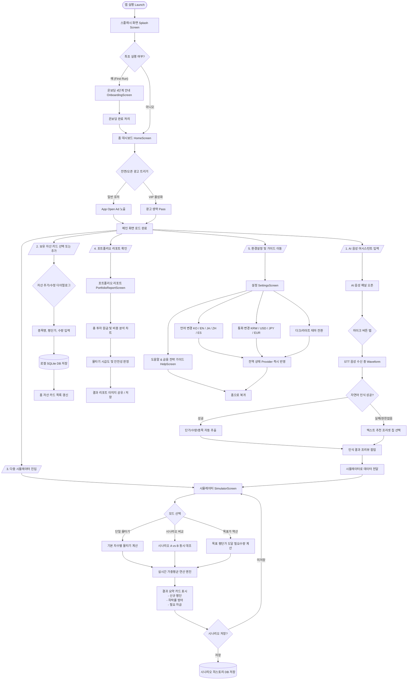
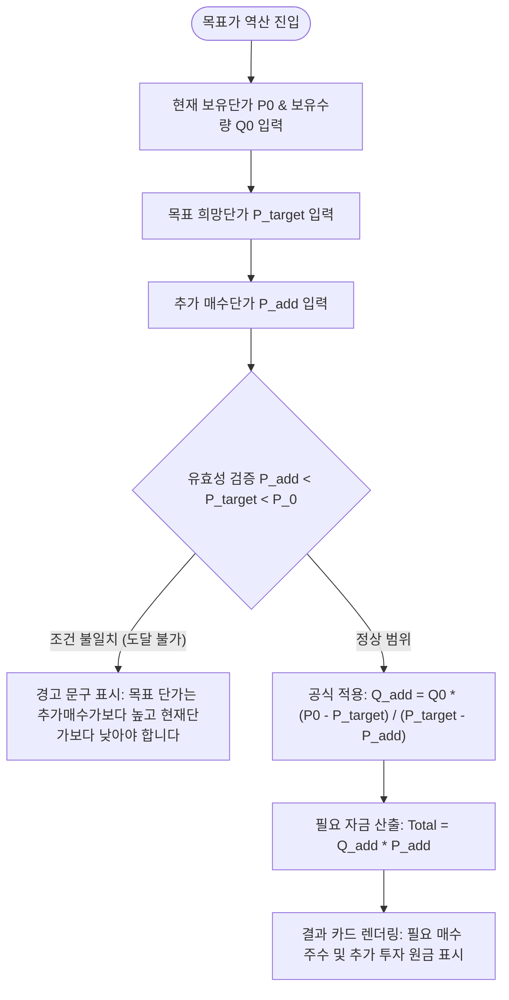
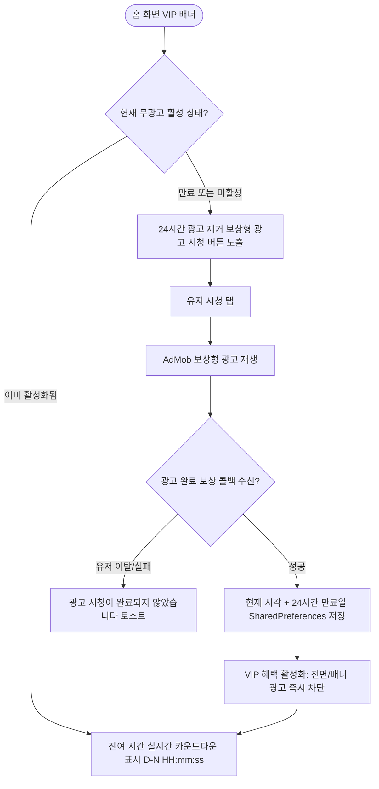

# USER FLOW CHART (사용자 여정 및 화면 전환 플로우차트)

**Project**: Smart Average Down Calculator (스마트 물타기 계산기)  
**Version**: 1.0.0+  
**Format**: Mermaid.js (`flowchart TD`)  

---

## 1. 전체 사용자 여정 다이어그램 (End-to-End User Flow)

---

## 2. 세부 코어 로직 플로우: 목표 평단가 역산 엔진 (Target Price Flow)

---

## 3. VIP 24시간 광고 제거 및 라이프사이클 플로우

